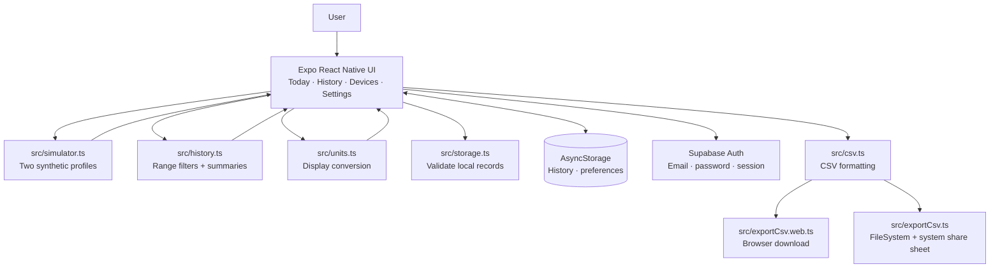

# Application architecture and decisions

**Status:** current prototype architecture  
**Prepared:** 15 October 2026

## Scope and context

Wearable Companion is a single-developer capstone prototype. There is no wearable hardware, Jira instance, or configured authentication project. The app includes an optional Supabase Auth integration and demonstrates a mobile-first interface using synthetic readings. It is not a production health-data system.

## Component view

`App.tsx` coordinates authentication, the simulator, storage, history, unit conversion, and export modules. When Supabase environment values are configured, registration/sign-in is required before the app opens and the authenticated user's ID scopes local storage keys. Without configuration, the app runs in a labelled synthetic-only demo mode. Samples are stored in Celsius; `src/units.ts` converts the display and export value when Fahrenheit is selected. The selected simulator profile refreshes readings every three seconds while running. Each new history record stores the selected profile ID, name, and type. No reading or preference is synchronized to a server.

## Data flow

1. The app loads locally saved preferences and synthetic history.
2. `src/storage.ts` rejects malformed history entries, removes duplicate IDs, sorts valid entries newest first, and applies the 200-entry cap.
3. While the simulator is running, `src/simulator.ts` produces synthetic heart rate, step-count, and temperature values for the selected fitness-band or smartwatch profile. The app adds timestamps and source identity, then updates Today.
4. The app stores each sample in AsyncStorage. History first filters records to the selected simulator profile, then to the selected rolling 24-hour, 7-day, or all-sample range, calculates per-metric summaries, and charts the latest 20 samples per metric within that range.
5. When requested, `src/csv.ts` serializes the selected local synthetic history range including source identity. The web adapter downloads a CSV; the native adapter writes a temporary file and opens the platform share sheet.

## Key design decisions

### ADR-001 — Expo, React Native, and TypeScript

- **Status:** Accepted for the prototype.
- **Decision:** Use Expo with React Native and TypeScript, including the Expo web target.
- **Reason:** It provides one codebase for the mobile UI and browser demonstration, which is manageable for one primary developer.
- **Alternatives considered:** Native Android/iOS projects would require maintaining separate implementations; a web-only app would not meet the intended mobile demonstration goal.
- **Consequences:** Expo-compatible packages and platform-specific adapters are used where necessary. The choice has not demonstrated BLE or NFC feasibility; no real hardware is available, and Android/iOS integration remains to be verified.

### ADR-002 — Synthetic device source for development

- **Status:** Accepted for the prototype.
- **Decision:** Generate clearly labelled synthetic metrics rather than imply that a physical device is connected.
- **Reason:** No wearable hardware is available, and the project prompt explicitly allows a simulator where hardware is unavailable.
- **Consequences:** The simulator supports interface and history demonstrations only. It is not a medical model, BLE implementation, or proof of hardware support. A formal device-source interface and real adapter remain future work.

### ADR-003 — Local-only persistence for the prototype

- **Status:** Accepted for the current synthetic-data scope.
- **Decision:** Use AsyncStorage for the capped local history and dashboard metric preferences.
- **Reason:** The prototype has no backend or accounts, and a small on-device store is sufficient for synthetic demonstration data.
- **Consequences:** AsyncStorage is unencrypted; data is not synchronized, account-separated, or backed up. Do not store real health or personal data. A secure backend, authentication, authorization, and retention design are required before real user data is introduced.

### ADR-004 — Platform-specific CSV delivery

- **Status:** Accepted for the prototype.
- **Decision:** Share CSV formatting in `src/csv.ts`, then use the browser download adapter for web and Expo FileSystem/Sharing for native platforms.
- **Reason:** Web and native platforms expose different file-delivery mechanisms.
- **Consequences:** CSV output is intended for synthetic sample data. Export has static type checking and lint coverage but still needs manual verification in each target environment.

### ADR-005 — Supabase email/password authentication

- **Status:** Accepted for the prototype; external project configuration is pending.
- **Decision:** Use Supabase Auth email/password registration and sign-in when a project URL and publishable key are provided through local Expo environment variables.
- **Reason:** The project requirements call for real authentication, and Supabase provides a managed Auth service compatible with the existing Expo app.
- **Consequences:** Configured mode requires a restored/authenticated session and provides registration, sign-in, and sign-out. Local records are namespaced by account ID. The publishable key is client-visible; database policies are required before exposing backend data. No Supabase project, remote database, RLS policy, SMTP, production configuration, or health data is connected. Session persistence uses AsyncStorage on native platforms and browser storage on web; this is not suitable for real health data without a reviewed secure-session design.

## Known architecture gaps

- Authentication is implemented but no Supabase project is configured. There is no backend API/table for app readings or preferences, no RLS policy, and no cloud synchronization.
- No BLE/NFC adapter, device discovery, physical-device selection, or simultaneous multiple-device connection. The two simulator profiles are not hardware support.
- The simulator is separated from the screen code as a module, but there is not yet a general device-source interface.
- AsyncStorage is not suitable for confidential health records.
- Android/iOS, native CSV sharing, and hardware integrations must be verified on their actual targets before claiming support.

## Future architecture gate

Before adding real user or health data, configure the external auth project, move session persistence to a reviewed secure-storage design, create the remote schema, enforce and test per-user RLS, define retention/deletion, and review privacy/security requirements. Before adding BLE/NFC, confirm device protocols and mobile platform support with compatible hardware. Keep simulator and hardware sources explicitly distinguishable in the UI and stored records.
